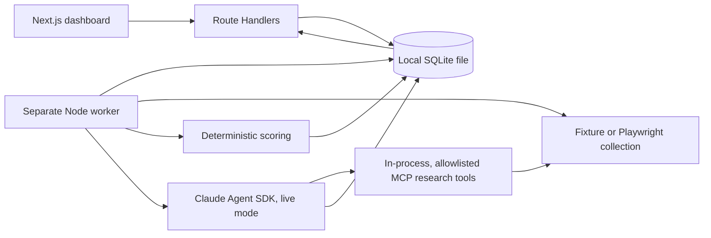

# Architecture

Presentation components use API responses only. Route Handlers validate requests and create/read job records; they do not run long browser or model work. The worker claims one pending job under a local database lock, owns a lease, records events, observes cancellation, and writes terminal state.

`sql.js` supplies SQLite without a native Windows compiler requirement. Each operation acquires an adjacent lock file, migrates the schema if required, writes an atomic temporary database file, then replaces the database. This is suitable for the single-worker local MVP only.

The live worker runs the real Agent SDK `query()` entry point with no built-in tools, strict MCP configuration, a bounded model budget/turn count, and an abort controller. Fixture mode deliberately uses a deterministic pipeline when no API key exists; it is never represented as Claude execution.

`/api/research-sources` exposes the actual runtime state as `deterministic_fixture`, `claude_agent`, or `live_agent_blocked`. A live job is rejected before queueing when `ANTHROPIC_API_KEY` is absent. The dashboard renders its stage, collection count, tool-event timeline, final estimated SDK cost, and report from persisted records only.

Source selection is registry-driven. Automatic requests resolve every available source compatible with the selected niche and runtime, persist that approved source pool, and let the Claude MCP workflow choose from it. Manual requests resolve exactly one compatible source. Job creation and collection independently re-check source availability, mode, and niche; selection events and product evidence persist the source that was actually used.
